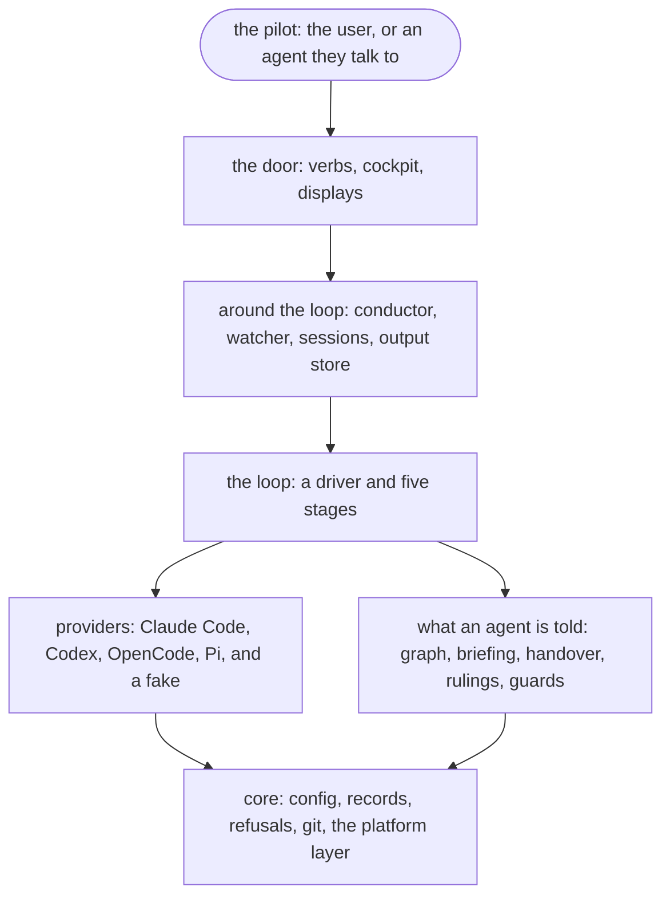
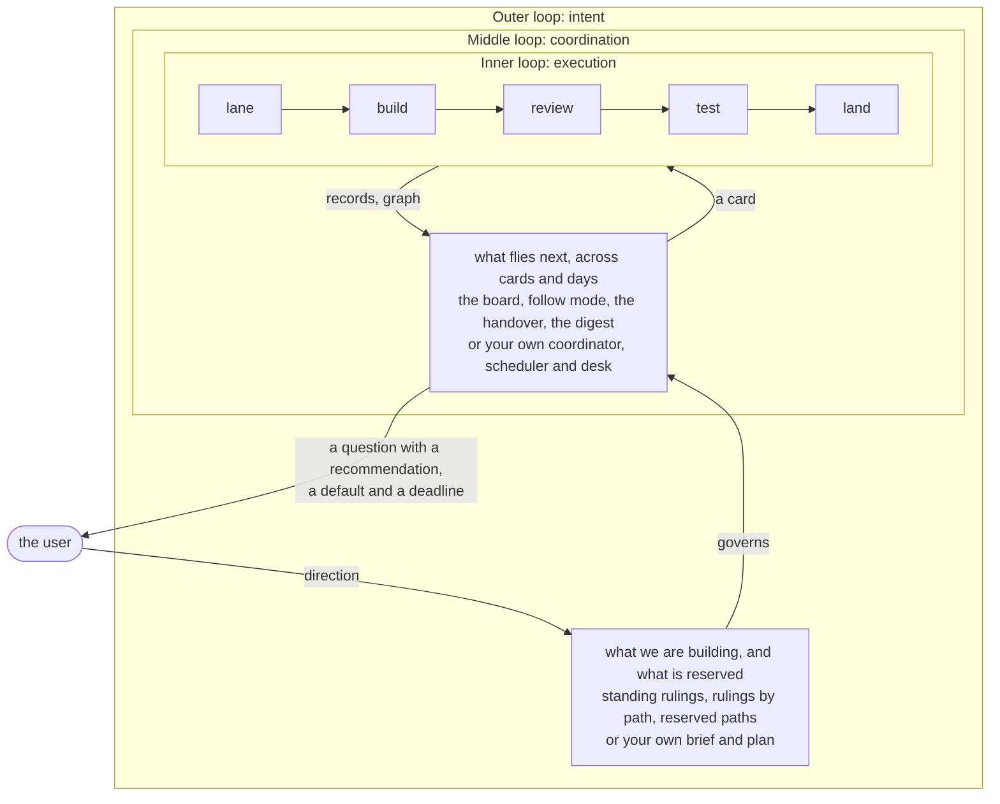
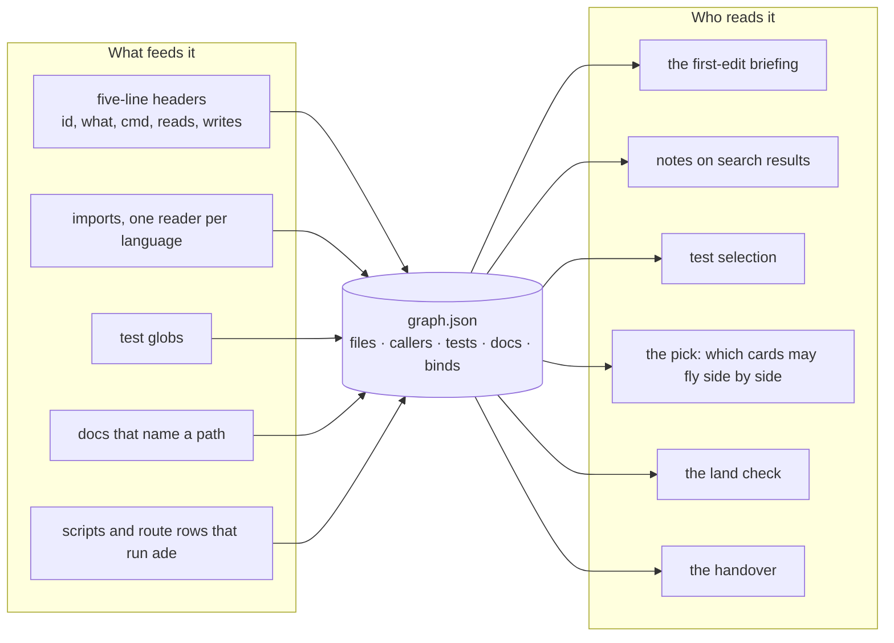
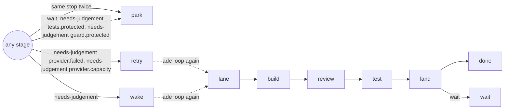

# Atlas ADE architecture

This file says how ADE is put together and why: its shape, its parts, what each part may cost in lines, how the parts fit, and the order they were built in. It describes the kit as released.

It holds what only prose can hold: the shape, the reasons and the rules. It does not copy what a command can print, because a copy is out of date the day after it is written. Where a list or a figure has an owner, this file names the owner:

| For | Ask |
|---|---|
| every verb | `ade -h`, or a bare `ade` |
| every setting, with its value and its comment | `ade config WORD` |
| lines, hooks, refusal codes and tests against their limits | `ade budget` |
| the parts and their switches | `ade parts` |
| what happens at each kind of stop | `ade graph --route` |
| the rules in force | `ade decide --rulings` |
| roles, models and effort | `ade config --roles` |
| what each harness gets | the porting guide: https://atlas-ade.dev/docs/porting/ |

The twelve design rules this file applies are listed in section 11, and cited as "rule 7" and so on.

## 1. The shape

### 1.1 One picture

Think of a small aircraft.

- **The user owns the aircraft and files the flight plan.** They say where to go (cards), set the rules of the air (rulings and `ade.toml`), and answer the radio when a question is theirs alone.
- **The pilot flies the board.** Pilot is a seat, not a person. The user can sit in it, but usually an agent session does, with the user talking to it.
- **The loop is the autopilot.** It flies the routine legs (lane, build, review, test, land) without waking anyone, and hands control back the moment something needs judgement, with the next command already on the screen.
- **The harnesses are the engines.** Claude Code, Codex, OpenCode and Pi, alone or side by side, each bolted on through the same mount (a provider adapter). ADE drives the vendor's own unmodified command-line tool. It packs no harness and no model runtime of its own.
- **Records are the flight recorder.** Append-only, written only by the instruments (verbs), never by hand and never by a model typing a marker.
- **The graph is the chart.** Generated from the ground itself (code, imports, headers, docs), never hand-drawn, so it cannot drift from the terrain.
- **The handover is the pre-flight briefing.** Any crew member, at a cold start or after their context was compacted, gets the same short briefing from one query.
- **The cockpit is the instrument panel.** Orca, herdr and the flight band are extra displays. A display shows the flight. It never flies the aircraft.
- **Refusals are stall warnings.** Few, loud, and each one says how to recover.

There is one control plane: ADE's loop. The harnesses and the displays are driven by it, and none of them drive it.

This picture is a map, not a rule. The real import edges are in the graph (`ade graph`), and the one file that reaches everything is the command door, because it discovers the verbs.

### 1.2 Three loops, one inside the next

ADE is three loops, like nesting dolls.

| Loop | Its job | The question it answers |
|---|---|---|
| **Inner: execution** | turn one card into one landed, tested, recorded change | are we building it right? |
| **Middle: coordination** | keep the right cards flying across sessions and days, and hold what must outlive one context window | are we building the right things, in the right order? |
| **Outer: intent** | keep all of it pointed at what the user wants, and guard their attention | is this still what we want, and what is the user's alone to decide? |

They are one loop, not three products. A function lives in a loop. It does not have to be a separate thing, and most of the outer loop is a few lines of text that every seat reads.

### 1.3 Each doll is a whole doll

Each loop is one working part of the loop outside it, and also a whole system that could stand alone. That matters most for the inner loop: a user with nothing but ADE and a terminal has no bigger doll to borrow from, so the inner loop has to carry every organ a system needs to stay alive.

This is our reading of Stafford Beer's viable system model. It is an interpretation, not a one-to-one copy.

| System | Its job | In ADE's inner loop |
|---|---|---|
| 1 operations | do the work | lanes and the five stages |
| 2 coordination | stop the operations clashing | the conductor, the graph's reach, one runway at land, the route |
| 3 control | today's resources and rules | the pilot seat, budgets, guards, call caps |
| 3* audit | spot checks | the review stage, card proofs, rehearsals |
| 4 the outside and the future | what is coming | drafted and recurring cards, the pick's drift notes, the digest. Thin on purpose |
| 5 identity | who we are and what we will not do | `ade.toml`, rulings and standing rulings, role voice files |

Beer's top system is mostly asleep. It sets identity, and it wakes on an alarm that bypasses everything below it. ADE's alarm line is a question: it goes to the user with a recommendation, a default and a deadline, and nothing else stops while it waits (section 3.5).

### 1.4 Bring your own middle and outer

ADE owns the inner loop outright. For the middle and outer loops it ships small seams, and lets the tools a user already has do the rest. The same kit fits all of these:

| Your setup | Middle loop | Outer loop |
|---|---|---|
| A terminal and nothing else | the board, `ade conduct --follow`, the cockpit, `ade digest` | standing rulings, and questions answered at `ade decide --desk` |
| A scheduler (cron, CI, a cloud routine) | the scheduler starts `ade conduct --follow`; ADE bounds the run: it stops when the day turns, when a provider is over its share of the week, or at a call cap if one is set | the same, with questions waiting on their defaults |
| A project workspace with agents (for example Claude projects) | a coordinator and its threads fly cards through ADE, scheduled tasks refill the board and send a digest, a shared page (an artifact) is the desk | a short brief and a one-page plan, read before anything is asked of the user |

The last row is how ADE itself is built and run. The seams are the same in every row:

- **State that outlives a session.** Durable records travel on their own git branch, and `ade handover` rebuilds a seat's context from records and graph, so a cold start and a resume are the same thing.
- **Stops a machine can read.** `--json` on `ade loop` and `ade conduct` prints one line per stop, and `ade wait` blocks on a condition with a bound.
- **Questions that never stall the board.** Each has a recommendation, a default and a deadline, and an answer is a record the loop reads on its next round.
- **Nothing that must stay awake.** ADE has no scheduler, no daemon and no always-on overseer. Anything on a clock is started by the platform's own scheduler.

### 1.5 Two rules that follow

**Build inside out.** Each loop multiplies the one inside it, mistakes included. A coordinator on top of a leaky inner loop only produces leaks faster. So the inner loop was made tight first, the middle was built on top of it, and the outer came last (section 10). A user adopting ADE should go in the same order: land one card by hand before conducting a board, and conduct a board before scheduling it.

**All work goes through the loop.** A loop with holes leaks. A change made outside it skips the briefing, the review, the tests and the record, so the graph and the records stop matching the code. The next agent trusts them a little less and goes round the loop too. The leaks widen and grind.

What closes the holes is structure, not vigilance:

- one writer per fact: only verbs write records;
- one door to trunk: landing is the only merge, `ade push` is the only push on the allow list, and a forced push is refused in every permission mode;
- every first edit of a file is briefed, inside a lane or out of it;
- land checks that the change fed the graph and that every script still matches the verbs it runs;
- the handover is rebuilt from records, so work that skipped the loop is simply absent from the next seat's context.

ADE is built this way itself: every change to the kit is a card flown by the kit.

## 2. Components and line budgets

Small is a design goal, so size is budgeted. There are four hard limits, set in `[budgets]` and printed by `ade budget`, which fails when one is over. A landing that would leave one over is taken back before anything is pushed.

| Limit | Value | Why |
|---|---:|---|
| core lines (no tests, no generated files) | 20,000 | the whole kit stays readable by one person or one context window |
| hooks | 8 | one job per hook; a new job takes a slot instead of hiding in an old hook |
| refusal codes | 50 | each must earn its place by firing on real mistakes |
| test functions | 200 | tests are invariants only (section 13) |

Below those sit guide rows, one per component. A guide row is a note, not a gate: it exists to stop any one part quietly bloating, and going over it prints "over (note)" and blocks nothing. The rows do not add up to the cap on purpose. The gap is reserve, spent only by an argued change.

| Component | Does | Guide | Platform feature that would let us delete it (rule 10) |
|---|---|---:|---|
| **core** | config load and merge, append-only records, the one `refuse()`, the git wrapper and the one push, verb discovery, the platform layer | 1,100 | none: this is the kit |
| **lib** | small helpers shared by the verbs | 500 | none |
| **graph** | files, imports, callers, covering tests, docs that name a file, script bindings; one reader per language; reach and test selection | 1,200 | a language-server index that exposes callers and covering tests |
| **brief** | the hook entry: first-edit briefing, protected paths, notes on search results, turn-end holds, the start handover | 400 | none today |
| **handover** | a role's working context from records and graph, inside a token budget | 500 | a harness session start that could run a query with a cap |
| **driver** | walk the stages, journal each one, stop at the first non-advance and print the next command | 500 | none |
| **lane** | a worktree per card, the builder call, the return contract | 500 | harness-native worktree agents |
| **review** | policy by path; the reviewer approves, edits the lane, or returns a patch applied once | 500 | a harness review command that returns an applicable patch on demand |
| **tests** | always-run checks, graph-selected tests, results cached by tree, one retry for timing-shaped failures, reds already on trunk carried | 600 | CI with path-based selection |
| **land** | the checks, one runway, the merge, a re-check on the merged trunk, one verdict, the outcome record | 700 | none (git does the merge; the record is ours) |
| **providers** | one call per harness from argv templates, a clean environment, usage read from the harness's own report | 800 | one shared way to define and call an agent across harnesses |
| **waits** | wait on a condition with a bound; read a silent lane as stalled | 200 | harness background tasks with a completion notice |
| **verbs** | the board, rulings and questions, the status line, budgets, the digest, config lookup, parts | 1,250 | none |
| **install** | start a project or install into one, read an existing repo's quirks, generate each harness's files, upgrade, uninstall, the parts panel | 1,500 | a harness-native project setup command |
| **conductor** | walk the board, route every stop from one table, wake a model only for judgement | 500 | none |
| **q** | the output store and its queries | 450 | a harness large-output file that could be queried and covered every harness |
| **sessions** | ade verbs run detached on every platform | 300 | background terminals that outlive the app on every platform |
| **guards** | refuse the named classes only | 300 | permission deny rules, once they can express every case |
| **telemetry** | local usage per call, per card and per week; an OpenTelemetry-shaped export | 900 | a per-project usage API with local export |
| **cockpit** | the board in the terminal, the home screen, the lane log, the display adapters and the flight band | 600 | a dashboard that read ADE's records directly |
| **rehearse** | one full loop per config option on throwaway repos with the fake provider | 400 | none |

The values above are settings as of this release. The enforced copy is `[budgets]` and `[budgets.components]` in the kit's own `ade.toml`, which also maps files to rows. Live counts are what `ade budget` prints, and every landing prints the net change per component.

Deliberately not components: a scheduler, notifications, a dashboard of our own, cross-session messaging and memory tooling. A platform or a display already does each of these (rule 10).

## 3. Data model

### 3.1 Config: `ade.toml`

One file, merged over the kit's bundled template: tables merge key by key, lists and scalars replace. A section left unset takes the kit default, so a first `ade.toml` can be a few lines.

`ade.toml` is the user's. An agent may not edit it (it is a protected path), with one exception: `ade parts set` and `ade setup` switch parts on and off and print the diff first. For any other key the agent names the key to the user, who changes it and reruns `ade init`, which regenerates every file ADE owns from it.

Every key carries its reason as a comment in the template, and `ade config WORD` prints each matching key with its effective value and that comment. That is the reference, so this file lists no keys.

Rule 11 in practice: a would-be refusal becomes a key. Someone who needs different behaviour changes config, not code.

### 3.2 Records: `.ade/records.jsonl`

One append-only JSONL file, locked per write, one writer per record type. A later row with the same id updates an earlier one, so a status change is one appended row and nothing is ever rewritten.

Records come in two kinds:

- **Durable rows** are the facts we would be sorry to lose: cards, decisions (rulings, questions and their answers), outcomes of landings, review verdicts, refusals fired, residual and recurring test failures, and the one flag that says a provider is over its share of the week. They are also written to a git orphan branch, `ade-records`, with plumbing only: no checkout, so the working tree, the index and the current branch never move. The branch is pushed like any other, so a fresh clone or a second machine gets the board and the rule book back.
- **Cache rows** are everything else: the journal of stage outcomes, review and test results keyed by lane tree, holds, sessions, usage. Losing them costs a rerun and nothing more. Usage rows are in this kind on purpose: no usage number leaves the machine.

Ids are minted per type as a prefix and a number (`c12` for a card, `d7` for a decision). Two machines that both minted `c5` between pushes are settled at the next push: the first to push keeps the id, the other's row is renumbered, and its lane, branch and log move with it.

Nothing else stores state. No hand-edited state files, no model-typed markers, no run logs in the tree.

### 3.3 The graph: `graph.json`

The graph is generated by `ade graph`, never edited, and `ade graph --check` says when a committed copy has gone stale.

It holds five kinds of edge:

| Edge | From | Used for |
|---|---|---|
| `files` | each source file: its header, its imports, its language, whether it is a test | everything below |
| `callers` | importers of a file; for a data or config file, the code whose header reads or writes it | the briefing, and the reach of a card |
| `tests` | the tests that reach a file through imports, transitively | test selection |
| `docs` | markdown that names a path | "update these in the same change" |
| `binds` | scripts and route rows that run an `ade` verb | the land check in 12.6 |

Three things about how it is built:

- **Languages are files.** Each reader is one file in `ade/lang/` (Python, TypeScript and JavaScript, Go, Rust, Java and Kotlin, C#, C and C++, shell), discovered by glob. Adding a language is adding a file.
- **A project's code never needs ADE headers to work.** The header is optional and makes briefings richer. The one thing only a header gives is an edge to a data file no import reaches: a JSON or TOML file is tied to the code whose `reads` or `writes` names it. Without that edge two lanes could meet only through the data file, both pass, and land the pair red. With it, the pick keeps them apart and the data file selects its readers' tests.
- **Staleness lives where prose describes code**, so the `docs` edge exists. The briefing names those docs on first edit and the agent updates them in the same change. History docs (changelogs, decision logs) are listed in `[graph] history` and make no such edge, so nobody is told to rewrite the past.

### 3.4 Roles and seats

Three roles: `pilot` flies the board, `builder` builds one card in its lane, `reviewer` reviews one lane diff. Each is defined once in `[roles.*]` (what it is, its tools, a model and an effort level per harness) and rendered for each harness in that harness's own format: agent files and settings for Claude Code, a generated block in `AGENTS.md` plus a hooks file for Codex, a plugin for OpenCode, an extension for Pi, and a generated skill that tells any agent how to run and configure ADE.

A seat is a role on a harness with a model and an effort level. `ade config --roles` prints them. A card can fly with a different seat for one run (`--model ROLE=ENGINE:MODEL`, `--effort ROLE=LEVEL`), and a profile swaps a role's voice, model and effort for a card that names it or whose paths match it.

Three choices worth knowing:

- Model ids go verbatim to the harness. ADE holds no model list.
- A lane is a main session, never a subagent of the pilot. On Claude Code a lane's own subagents are off by default, because a card already gives its builder one brief and one context. A role opts back in with one key.
- `ADE_PROVIDER=fake` overrides every role, so tests and rehearsals never spend usage.

### 3.5 Rulings and questions

**Rulings** are how a decision outlives the session it was made in.

- A *path ruling* (`ade decide --path GLOB TEXT`) governs the files its globs match. It is delivered just in time: in the builder's prompt for a card on those paths, and in the first-edit briefing of a matching file. An agent working elsewhere never reads it.
- A *standing ruling* (`ade decide --standing TEXT`) has no path. Every role's handover prints it first, and every lane's prompt carries it. This is where a user's direction, values and reserved list live, so it is added only on the user's own word: written from any seat but a person's own terminal it is a proposal, and it governs nothing until the user answers `stand`. A user who wants an agent to answer for them says so in one setting.

The rule book is kept small by the same means as the code. It has a counted limit for rulings and a smaller one for standing rulings (`[budgets]`), which only `ade.toml` raises. Each ruling carries a review date, and a ruling due for review still governs: the user answers `keep` or `retire: WHY`. A ruling is retired, never deleted. Read the book before adding to it: `ade decide --rulings`.

**Questions** are the alarm line to the user (`ade decide --ask`, and every park). Each carries a recommendation, a default and a deadline, so silence never stalls the board: at the deadline the default applies. The exception is a question guarding a reserved path (`[land] ask`), which has no default and waits.

- Machine-read answers fail closed. A retry, land or accept question takes only its listed forms, and anything else is refused with every valid form printed.
- The desk is `ade decide --desk`: a walk through the open questions, one answer each. The cockpit opens it with one key and writes no record itself.
- Every answer is stamped `person`, `agent` or `unknown`, read from the harness's own environment markers. The stamp is a label, not a lock: it catches the careless case, not a determined agent. ADE does not police models. The rule it gives every agent is one sentence: never answer a question as the person.

## 4. The loop

### 4.1 The driver

`ade loop CARD` walks five idempotent stages. Each returns one of four outcomes and the driver journals it:

| Outcome | Meaning | The driver |
|---|---|---|
| `advance` | this stage is satisfied, or already proven for this tree | goes to the next stage |
| `wait` | something outside the loop must change (the main checkout is off trunk, or holds edits the card would touch) | stops, prints the next command, wakes nobody |
| `needs-judgement` | a model or a person must decide | stops and prints the next command |
| `done` | landed | stops |

A refusal inside a stage becomes a `needs-judgement` row with its cure as the next command. Rerunning `ade loop` after any stop resumes where it stopped, because review and test results are cached by the lane's tree hash. A model is woken only to build, to review and for judgement. Everything else is a script.

Every refusal that fires also writes a durable row. A code earns its place by firing: `ade budget --refusals` lists every code with its firings and how many were on cards that landed anyway, so a code that never fires, or fires on work later accepted, is retired before a new one is added (rule 7).

### 4.2 The five stages

1. **lane.** A git worktree per card, on branch `ade/<card>`, under `$ADE_WORK` and outside the repo, so lanes never appear in its status or its graph. The pick notes two things without stopping for either: files under the card's paths that trunk changed since the card was written, and code-like names in the card that none of its files contain. The builder is told both.
2. **build.** The builder role runs in the lane with the card's title, paths, done line, the rulings on those paths and any note a person attached. The driver commits. The contract: something changed, or the builder says the done line was already met and the card closes. A file changed outside the card's paths is named to the reviewer as a stray. It is a warning for a reader with judgement, not a stop.
3. **review.** `none` when every touched path is prose, otherwise one light review by the reviewer role. The reviewer approves, edits the lane directly, or returns a patch that the driver applies once. There is no second round, and a patch that does not apply is `needs-judgement`. Two opt-ins: opposite-engine review, where Claude Code and Codex review each other's builds, and forked review, where each review branches from one parent session that has already read the project's standing documents.
4. **test.** Always-run checks first (a typecheck, for example), then the tests the graph says reach the touched paths. An unknown or untested path adds the configured critical set, and prose selects nothing. A change touching a proof-grade path runs the whole suite. A timing-shaped failure gets one isolated retry. A test that is also red on trunk is carried as a residual instead of blocking the card.
5. **land.** Requires an approved review and passing tests for the lane's current tree. Before the merge it checks that the change fed the graph (4.3) and that no script has drifted from its verbs (12.6), refuses a lane that changed protected config, and asks the user first when a reserved path is touched. Then, holding the one runway: merge with a merge commit, re-check on the merged trunk when trunk moved under the lane, write one verdict and one outcome, carry residuals to their one card, remove the lane, and push as `[git] push` says (4.4).

That diagram is printed by `ade graph --route` from the route table itself (12.2). If the route changes, run it again.

### 4.3 Feeding the graph

The graph is only as good as what agents feed it, so feeding it is told at one moment and checked at another:

- **On edit, told.** The first-edit briefing says what the file lacks: "no test reaches this file; add one only for a lasting invariant", or "no header". Editing is never blocked for this.
- **On land, checked.** For every code file the lane added or changed, the lane's regenerated graph is read against `[graph] require` and `[graph] note`. Whatever `require` lists and is missing stops the loop with the cure. Whatever `note` lists and is missing lands, and the outcome record keeps it as "noted, not blocking", so the gap is visible without holding up work.

By default a missing test is noted and never blocks, because tests are meant to be few (section 13). A new project started on ADE requires the header, which is cheap and is what briefings and handovers read. A ported project requires nothing, so its existing files need no ADE-specific edits. A project that wants tests enforced moves `tests` into `require`.

### 4.4 Git, end to end

ADE owns git from the worktree to the push, so nobody pushes by hand.

- **Lanes are worktrees**, one per card, each on its own branch. Many can build at once.
- **Landing is the one door to trunk**, and there is one runway: land holds a lock from its checks to its push, so each merge and its check see a trunk that holds still. If trunk moved under the lane, land reruns what the change reaches on the merged trunk, and takes the merge back if that fails. Nothing was pushed yet, so nothing is rewritten.
- **`ade push` is the one push.** It sends trunk, the `ade-records` branch and tags matching `[git] push_tags`, and nothing else. Every refspec names the same ref on both sides with no `+`, so git itself refuses anything that is not a fast-forward or a new ref. ADE has no force option to override it. Credentials are git's own.
- **Three push modes.** `land`: every landing pushes. `manual`: only `ade push` pushes, which a first `ade init` chooses by itself when a push to trunk would start a deploy. `pr`: for a protected trunk, a landing pushes the card's branch and opens a pull request, and never pushes trunk.
- **One deletion.** In `pr` mode, remote card branches that trunk already contains are pruned, each with a lease on the tip that was checked. One key turns it off.
- **Records merge, never rewrite.** When two machines both appended to `ade-records`, the second push fetches the other tip and commits a merge holding the rows of both.

A raw `git push` is never on the allow list. The guard refuses an agent's force push or `+` refspec in every permission mode.

## 5. Hooks (at most 8, one job each)

A hook does one thing. A new job gets its own hook and takes a slot, which is what keeps the cap honest.

| Event | Verb | Does |
|---|---|---|
| before an edit | `ade hook brief` | refuse protected paths with the cure; otherwise brief the first edit of a file in a session: what it is, its callers, its tests, the rulings on it, the docs that describe it |
| before a shell command | `ade hook bash` | refuse the named classes only: reading secrets, destructive deletes, history rewrite, writes to protected config |
| before a read or search | `ade hook read` | refuse reads of secret files through the harness's own read tools |
| after a search | `ade hook grep` | add graph notes for the top result files; never blocks, rewrites or shortens the result |
| at the end of a turn | `ade hook turn-end` | record what the turn waits on as a hold |
| at session start, resume and compaction | `ade hook start` | inject the role's handover, so a cold start and a post-compaction re-entry are the same thing |

Two of these earn a word on why they are shaped as they are.

The search hook reads the output, and of the command only each program's name, to know a search ran. It never reads the pattern, the flags or the pipes. Parsing those (quoting, the flag dialects of each search tool) is where such a hook's cost and bugs live, and the output already names the files. It is context, not a control, so nothing is gated on it and any error stays silent. Where a harness's hook payload is not documented, the hook reads it tolerantly rather than assume one shape.

The guard refuses classes, not commands. Blocking happens only for the named error classes. Everything else adds context and never refuses, because a rule that fires on correct work is a defect (rule 7).

**Each harness gets the same six in its own format**: local settings for Claude Code, a hooks file and per-lane flags for Codex, a generated plugin for OpenCode, a generated extension for Pi. Where a harness asks its user to trust hooks before it runs them, that decision stays the user's. ADE never accepts a trust prompt for the person and never passes a flag that bypasses one. What each harness gets today is in the porting guide's table, and `ade config --probe --guards` proves the secret guard on the user's own machine, for one tiny call per harness.

### 5.1 Permission modes

Lanes may run in the harness's bypass mode, because a lane is its own worktree. The safety does not come from permission prompts. It comes from structure that holds in every mode: the edit and shell hooks run before every edit and every command, protected config cannot be edited by an agent, history is never rewritten, and nothing lands without review and the tests the graph selects. Where the operating system offers it, each lane also runs inside a read sandbox that denies the secret files.

`[permissions]` sets the mode for the user's own sessions and for lanes, and every allow and deny rule carries its reason in `ade.toml`, because a settings file cannot hold comments.

ADE is not infallible and does not try to be. A model set on misbehaving will find a way past any number of doors. The guards exist to catch the common, costly mistakes loudly, and to keep the kit small.

## 6. Providers

A provider is an adapter behind one call: run this role with this prompt in this folder, and return its text and its usage report.

- **Four harnesses and a fake.** Claude Code, Codex, OpenCode and Pi are each started from an argv template in `ade.toml`, so a changed command-line flag is a config edit, not a release. The fake is built in, deterministic and free, and every test and rehearsal uses it.
- **The meta-harness rule.** ADE packs no harness and no model runtime, and never invites a first-time install of one. It runs the vendor's own tool under the user's own login, never reads or stores that login, and can run on an API key instead: a provider's `secrets` loads a key file into that one call's environment only.
- **A clean environment.** Each call drops what a host agent session would leak into its child, so a lane started from inside a session behaves like one started from a plain terminal, and its effort and cost are what its role says. Keys and tokens never reach a lane, apart from the harness's own.
- **Honest instruments.** A provider that cannot report something reads "unknown" or "not reported", never 0. An instrument that reads green over nothing is worse than none.

### 6.1 Observability: kept in, never sent out

Telemetry and logs are wanted. Telemetry leaving the machine is not.

- **Per call.** Each harness reports its own usage when run headless. The adapter writes one usage row per call, tagged with card, stage and role. No transcript scraping, with one exception: `ade telemetry --week` is the one reader of a harness's own session files. It reads only usage metadata (token counts, model, timestamps, entrypoint, the sidechain flag, and the ids it uses to drop duplicates), never message text, and nothing it reads leaves the machine.
- **Per card and per week.** `ade telemetry` prints usage per card and per provider. Where a harness reports a weekly window, the cockpit and the status line show it against the share of the week the user allows the kit, and the conductor parks instead of waking a model once a provider is over its share.
- **Per day.** `ade digest` is one short summary: cards landed, cards parked with their open question, and questions whose default applied.
- **Portable format.** `ade telemetry export` writes OpenTelemetry-shaped files locally, so any OpenTelemetry tool can read them.
- **Nothing goes out.** The kit's own code opens no network connection. Git and the harnesses do their own talking. No usage number is ever in what git carries: the one usage fact on the records branch is a yes or a no, whether a provider is over its share, with the time that lasts until.
- **Logs.** A lane's output goes to its own log, which `ade watch` follows on any platform. At land it is kept with the most recent few, so what each engine said can be read afterwards.

## 7. Cockpits

**The terminal cockpit is the reference, complete on its own.** `ade cockpit` prints every open card with its state and next command, the questions waiting and the budgets. `--follow` redraws it live. `ade status --line` feeds a status line, and a bare `ade` prints a home screen with the state of this folder and every verb.

The cockpit is where a person looks, so it is also the way to the desk: one key hands off to `ade decide --desk`. That is the cockpit's only input. It is a view, and it writes no record.

**Everything else is a mirror of the same records:**

| Display | Shows |
|---|---|
| the flight band (Claude Code) | the flying card's five stages above the prompt, and a note when it lands or parks |
| Orca | each lane as a worktree with a terminal following its card, each stop as a status comment |
| herdr | each lane as a tab, each stop as agent state |

A display never drives. ADE does not use any display's tasks, mailboxes or approval gates to move work, because that would be a second control plane. Any display failure is a printed note and the loop flies on. With every display off, nothing is missing.

There is no tmux anywhere in the kit: it does not exist on Windows, and detaching is a few lines of standard library (12.4).

## 8. Platforms and neighbours

### 8.1 Windows, macOS and Linux

ADE is Python 3.11 or later, standard library only, with no dependencies. The platform differences are few, and they live in one file so nothing else has to think about them:

| Difference | How ADE handles it |
|---|---|
| file locks | one `lock()` helper, with the right primitive per platform |
| `python3` is not a command on Windows | test and tool commands use `{python}`, filled with the interpreter running `ade` |
| paths | `pathlib` everywhere; graph and records store forward-slash repo paths, so they are identical on every machine |
| line endings | generated files are written with `\n`, and `ade init` adds the `.gitattributes` lines that keep them so |
| long paths on Windows | lane folders are short: a hash and the card id |
| shared dependency folders | a lane links them from the main checkout (a junction on Windows) instead of installing again |
| detaching | a new session on macOS and Linux, a new process group with no console on Windows |
| where `ade` is | hooks call `ade` when the one on PATH is this kit, and otherwise the absolute path of the one that ran `ade init`; they live in a local, untracked settings file, so the committed settings stay portable |

### 8.2 Living beside other tooling

A developer's machine is shared ground: other agents, other harness configurations, other projects. ADE is a good neighbour by construction, and one test reads the kit's own source to keep it so:

- the command is `ade` and its variables are `ADE_*`;
- it installs nothing machine-wide. Outside a project it writes three things only: lanes under `$ADE_WORK`, one small per-user usage file in the user's config folder, and, when the user runs `ade link`, one launcher in a per-user folder already on PATH;
- it never edits the user's own harness settings in their home folder;
- it starts no background service: no scheduled jobs, no daemons, no terminal multiplexer;
- its block in `AGENTS.md` sits between markers, and the user's own instruction files are left alone, so `ade uninstall` removes everything ADE generated and loses nothing of theirs.

## 9. Porting an existing project

New projects started on ADE are the main path (`ade init` in an empty folder makes the repo, a starter with one passing test and a first card). Porting is the second, and it reuses everything. The standard it is held to: **an existing project runs its loop on ADE with no kit-specific edits to its code.**

What that asks of the kit, each learned from a real port:

1. **The first `ade init` reads the repo's quirks** and writes safe values into the first `ade.toml`, printing each finding with its reason: the trunk it is on, branch mirrors already configured in git, workflows that would deploy on a push (which sets push to manual), dependency folders a lane should link, and the project's own test and typecheck scripts.
2. **The graph reads the project's language** without headers (3.3), including path aliases where the language has them.
3. **Tests run the project's way.** One runner handed many files, or one command per test file, plus commands that always run. A project with its own selection logic can name it, and the exit code is the verdict.
4. **Harm is declared, not guessed.** The project lists its proof-grade paths, the ones whose output can cause harm, and those run the whole suite. Everything else is orchestration-grade: fail loud, retry cheap.
5. **It coexists with what is there.** Existing agent settings are merged, not replaced. Existing rulings can be imported once.
6. **A friction found in a port is fixed in the kit**, never patched in the project. A fix that lives in one project proves nothing about the kit.

The porting guide has the steps. Try it with `ADE_PROVIDER=fake` first: the loop runs end to end on the project's real tests and spends nothing.

## 10. Build order

The kit was built inside out (1.5), each wave landing through the loop the wave before it had made:

| Wave | What was built | Loop |
|---|---|---|
| 1 | The skeleton: install, config, one lane, review, tests, merge, record, graph, handover, a cockpit stub. Run end to end twice from a clean clone before anything was added | inner |
| 2 | One loop made trustworthy: component budgets, the platform layer, hooks and guards, real harness runs, review patches, reds on trunk carried, durable records on their own branch, questions with defaults, telemetry, uninstall, rehearsals, and the first port of an existing project | inner |
| 3 | Around the loop: ADE's own push, the output store, the watcher, the conductor and its route, sessions | inner, system 2 |
| 4 | Many cards at once: lanes side by side kept apart by the graph, one runway at land, follow mode, the digest, the parts and their switches, a third harness | inner, reaching into middle |
| 5 | A board that looks ahead: drafted cards with a veto window, recurring cards, card proofs, pull-request mode, paths that land only on a person's answer, operating-system secret guards | middle seams |
| 6 | Seats and screens: more language readers, config lookup, profiles, the flight band, a fourth harness, the person or agent stamp on answers | all three |
| 7 | Intent: the rule book with its limits and review dates, standing rulings, the desk | outer seams |

From the second wave on, the kit was installed on itself, and every change to it has been a card.

## 11. Design rules and settled decisions

The twelve rules. Each is a yes or a no.

1. Each path has one of two rigour levels, set in config. The kit's own files are orchestration-grade, except the code that lands and pushes.
2. Nothing is hand-registered: every list, edge and index is generated.
3. Each fact has one writer, a verb. Storage is plain files or one SQLite file.
4. Facts come from graph queries, decisions attach to paths, procedures are scripts, history is never loaded.
5. Comments say why and how to change. Who, when and which session live in git and records.
6. Core code stays within its line budget, and every landing prints net lines per component.
7. Every refusal names its cause and its cure. One that fires on correct work twice is a defect.
8. Tests sit at the edges and assert invariants: no literal pins, no count pins, no tests of tests, none added by reflex.
9. Each harness is an adapter. Agent definitions are generated per harness from one source.
10. Platform first: each homegrown part names the platform feature that would let us delete it.
11. Configuration over code: a would-be refusal becomes a setting where it can.
12. An incident buys an exhibit, not a rule. A new check takes a budget slot or the user's word, and to add one, remove one.

Settled decisions that shape the rest of this file:

- ADE is a meta-harness. It packs no harness and no model runtime (section 6).
- It runs on Windows, macOS and Linux (8.1).
- New projects are the main path. Porting is second (section 9).
- Review is none or light. Opposite-engine review is an opt-in (4.2).
- Agents feed the graph: told on edit, checked on land. A missing test is noted, not blocked (4.3).
- ADE owns pushing, fast-forward only, and history is never rewritten (4.4).
- Durable records live on their own branch (3.2).
- Bypass mode is allowed in lanes, because structure carries the rules in every mode (5.1).
- Guards refuse named classes and warn about the rest. Labels, not locks (3.5, section 5).
- No telemetry leaves the machine (6.1).
- A display never drives (section 7).
- No scheduler, no daemon, no always-on overseer. The platform's scheduler starts what runs on a clock (1.4).

## 12. Around the loop

`ade loop` is the autopilot for one leg. This section is the layer that strings legs together: the **conductor** is the flight plan that says what to do at each kind of stop, the **watcher** is the ear on the radio that knows "quiet" from "the radio is dead", **sessions** are the engines left running while the pilot steps away from the panel, and the **output store** is the recorder's tape drive, where everything is kept and only the summary comes up on the screen.

### 12.1 Why a layer above one card

One card's happy route is a script. Without a layer above it, something still has to pick the next card, handle each stop the same way every time, and decide whether a stop truly needs a model. Done by hand, or by an agent spending a turn on each stop, that is exactly the cost the loop exists to remove.

### 12.2 The conductor and the route

`ade conduct` runs `ade loop` on each open card and routes every stop through one table, `ade/route.toml`. The table is data, so changing what happens at a stop is an edit to one file, not to code (rule 11). The most specific row wins, and there are four actions, and only these:

| Action | Does | Wakes a model? |
|---|---|---|
| `retry` | runs the loop once more (an engine blip); the same stop twice parks | no |
| `wait` | the watcher waits on the stop's condition, with a bound, then runs the loop | no |
| `wake` | calls the pilot role headless with the stop, then runs the loop; the same stop twice parks | yes, the only one |
| `park` | leaves the card with a question for a person, and moves on | no |

So a clean board costs no model turns beyond build and review, and every turn the pilot does spend is a recorded judgement. A card that has woken a model too often parks. Before any wake the conductor reads that provider's share of the week, and parks instead of waking when it is spent.

**Lanes side by side.** `ade conduct --lanes N` keeps up to N cards flying, each in its own session, and picks again as each ends. It is a script and no model. A card is free when its reach (its files, their callers and the tests that reach them, from the graph) meets no card already flying. What is flying is read from live sessions, never stored. Each lane wakes its own pilot only for its own card, so nothing pilots the whole fleet.

**Follow mode.** `ade conduct --follow` keeps going as cards are added, until the day turns over, a provider is over its share of the week, or a call cap is reached if one is set. Nothing in ADE schedules it. A person starts it, or the platform's scheduler does.

### 12.3 The watcher

One waiter, used by the conductor and by any session. `ade wait CONDITION --bound 30m` waits for a clean checkout, a new journal row, a stage, an answered question, a process to end, a file or a time. Its exit code says which way it ended: the condition was met, the stage parked, the bound passed, or the thing it was watching went silent. Silence is a reading, not "quiet": a lane whose engine is alive but whose log has stopped growing is reported as stalled.

Every wait has a bound. There is no "wait forever". An agent session waits the platform's way: it runs `ade wait` as a background command and is told when it ends, with no polling turns and no extra hook.

### 12.4 Sessions

`ade session start NAME -- VERB` runs one ade verb detached from the terminal that started it, with its output in a log. `list` shows each session live or ended, read from the process itself and not from a row. `attach` follows it and `stop` ends it. Only ade verbs can run as sessions, so this is a way to leave the conductor running, not a general job runner.

Detaching is standard library on every platform. That is the whole reason no terminal multiplexer is needed: it would give detach and panes, the first is a few lines of `subprocess`, and a display already gives panes to anyone who wants them.

### 12.5 The output store

Big tool output is the cheapest way to waste a model's context. Three layers, cheapest first:

1. **The platform's cap.** Where the harness already keeps very long shell output out of context, ADE leaves it alone, and one key lets a project tighten it without ever overriding a value the user set.
2. **ADE's own output.** Anything ADE prints that can be long (a failing test, a review patch, a records query) goes through one helper. Short text prints whole. Long text goes into the store, and the screen gets the head, the tail, the error-looking lines and a handle to page or search the rest.
3. **`ade q run -- COMMAND`** does the same for any command an agent expects to be long, passing the exit code through.

The store is one SQLite file. It also loads records and graph as tables, so "which open cards touch files no test reaches" is one read-only query instead of a model reading three files. It is an index and a cache, never the source of a fact: it is untracked, it can be deleted at any time, and output past its keep window is dropped.

Not done, on purpose: rewriting an agent's shell command to wrap it in `ade q run`. Permission rules would then see the wrapper instead of the real command, which opens a hole in the guard to save context the platform already saves.

### 12.6 Binding scripts to the verbs they run

When the loop's flow changes, the scripts that drive it must change with it. The pattern is the same as feeding the graph: told on edit, checked on land.

- **The graph gets `binds` edges.** A script is the route table plus any file matching `[graph] scripts`. Each `ade <verb>` line a script runs is an edge from the script to that verb, and each route row is an edge to the verb it runs and the stage it names.
- **On edit, told.** The first-edit briefing of a verb or stage names the scripts and route rows bound to it.
- **On land, checked.** Land validates every script and route row in the lane: each verb exists and each line parses with that verb's own parser; each stage, outcome, refusal code, role and wait condition a row names exists; and every stage and outcome the driver can return is covered by a row. A failure stops with one refusal code and names the row, the verb and the cure. `ade graph --check` runs the same validation, so CI catches it too.

Why validate, and not demand "if a verb changed, its scripts change in the same commit": a verb can change inside without its callers needing to, and a rule that fires on correct work is a defect (rule 7). What can break a script (a renamed verb, a new required argument, a stage nobody routes) is exactly what validation sees. What validation cannot see, a verb that now means something different, is what the briefing tells the agent while it edits.

This binds the kit's own route and any project's scripts that call `ade`, so a ported project's CI gets the same guarantee with no project-specific code.

### 12.7 Parts

Not every project wants every part. The parts catalogue names what can be switched off, what each part needs, and what it leans on: the displays, the graph, review, the conductor, the generated skill, the flight band and the branch mirror. `ade parts` lists them, `ade parts set NAME=off` switches one and prints what that costs, and `ade setup` is the same as a terminal panel that shows the `ade.toml` diff before it saves.

The airframe has no switch: cards, records and the driver. A loop with those three and everything else off still lands a change and records it.

## 13. Testing

Two different things get called testing, and ADE keeps them apart.

**Proof of done** is evidence for one card, once: a command and its output, a page that loads, a figure with its denominator. A card names its proof in its done line, and `--proof CMD` makes land run it. Proof is not a test and it is not kept.

**A kept test** guards a lasting hazard. It asserts an invariant or a refusal code, never copied text, counts or lists: "the date is dd/mm/yyyy" stays true, "the date is 17/11/2026" is true only today. A test written in the moment slows development more than it catches, so the suite has a hard cap and a card does not need a new test. `ade budget --tests` names any test that keeps going red on cards that never touched it, to be replaced or retired.

**Rehearsal is the main proof of the kit itself.** `ade rehearse` flies one full loop per config option on throwaway repos with the fake provider: a newcomer's first card in each starter language, an install into an existing repo, lanes side by side, each kind of stop, a resume, the graph and review switched off, a display that is not there. It reports calls, wall time and refusals. Unit tests guard edges. Rehearsals show the aircraft flies.

**Rigour is by path, not by mood.** A proof-grade path runs the whole suite, in the lane and again on the merged trunk. In the kit itself that is the code that lands and pushes, because a fault there puts unreviewed or broken bytes on a remote, which is the one real harm the kit can do.

The full guide is `docs/testing.md`.
