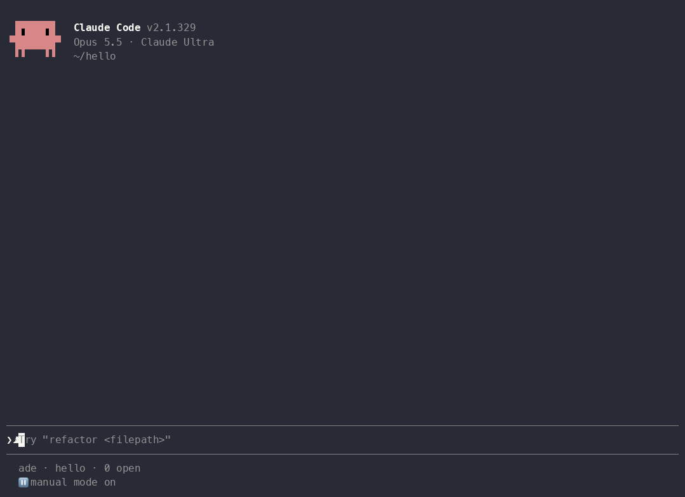

# ade

A small agentic meta-harness, so that your usage goes on building.

Atlas ADE drives Claude Code, Codex, OpenCode or Pi through one loop per card (lane, build, review, test, land), keeps a generated graph of your code, and records what every card cost.




```sh
uv tool install atlas-ade    # or: pipx install atlas-ade
```

```sh
ade init                                          # in your repo: settings, hooks, a first graph
ade card add "say hello" --path hello.py --done "it prints hello"
ade loop c1                                       # lane, build, review, test, land
```

You need git and one of Claude Code, Codex, OpenCode or Pi, installed and signed in. To try it without spending anything, run `ade rehearse`.

No account, no dependencies, nothing phones home. Python 3.11+ and the standard library.

ADE runs each vendor's own unmodified CLI under your login. It never reads or stores that login, and it can run on an API key instead.

## What makes it ADE

- **Cards, not chats.** Each change is a card with its files and a done line. ade card add writes one; `ade cockpit` shows them all.
- **One loop per card.** Lane, build, review, test, land, each card in its own worktree. A separate reviewer seat can send the work back.
- **A graph of your code.** Each lane gets a briefing on just the files its card touches, so agents stop re-reading the whole repo.
- **Usage per card.** `ade telemetry` shows what each card cost, per engine, every week.
- **Small on purpose.** The core is capped at 20,000 lines and 8 hooks, and `ade budget` prints where it stands. Small cards keep each diff, review and fix small.

## Where this came from

ADE was built in private first, by Connor Roberts at Practice Atlas Ltd, using ADE itself. Public history starts here, and from now on every landed card is one public commit.

## More

- Any issues? [Open an issue on GitHub](https://github.com/The-Anthropocene/ade/issues), or email support@atlas-ade.dev.
- Work with me: I can set ADE up in your repo, port your existing agent workflow onto it, or work contract days on agent tooling. Email support@atlas-ade.dev.
- Docs: https://atlas-ade.dev/docs/ (install, quickstart, the verbs)
- How the loop works: [ARCHITECTURE.md](https://github.com/The-Anthropocene/ade/blob/main/ARCHITECTURE.md)
- Contributing: [CONTRIBUTING.md](https://github.com/The-Anthropocene/ade/blob/main/CONTRIBUTING.md)
- Licence: MIT, see [LICENSE](https://github.com/The-Anthropocene/ade/blob/main/LICENSE). The Atlas ADE name and logo are not part of the licence.
